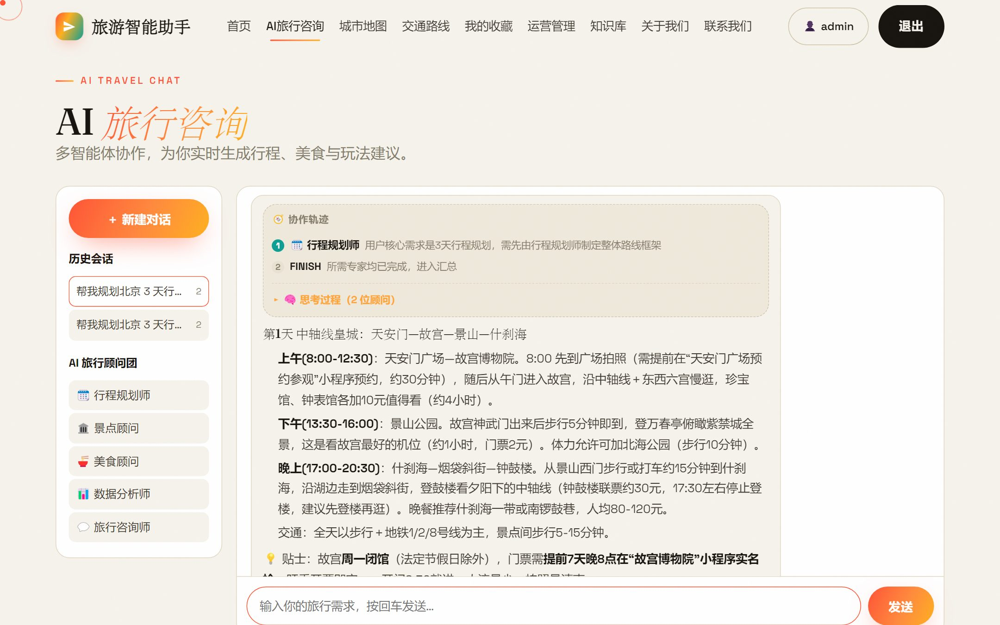
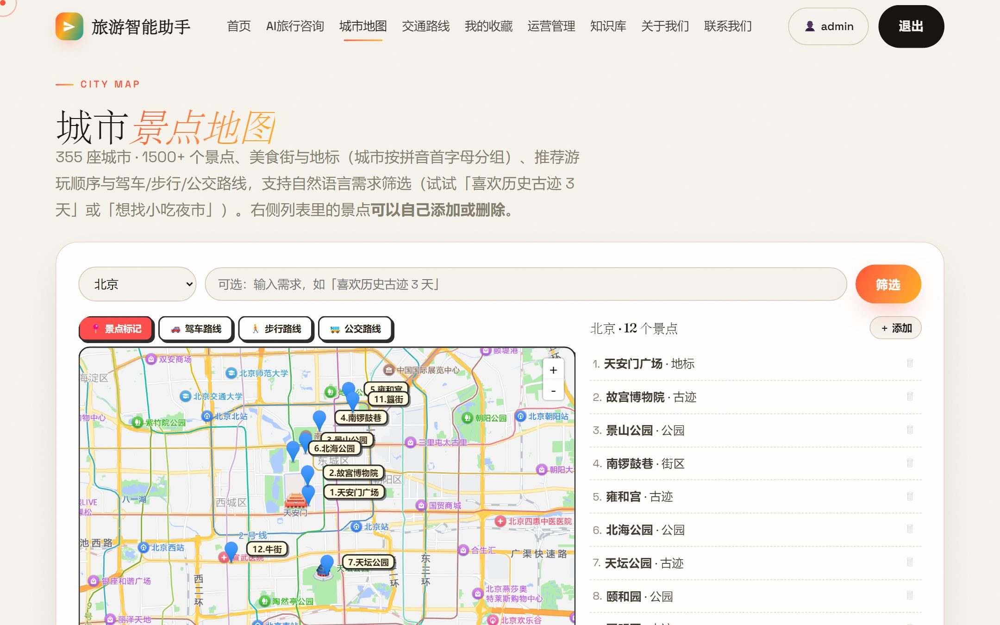
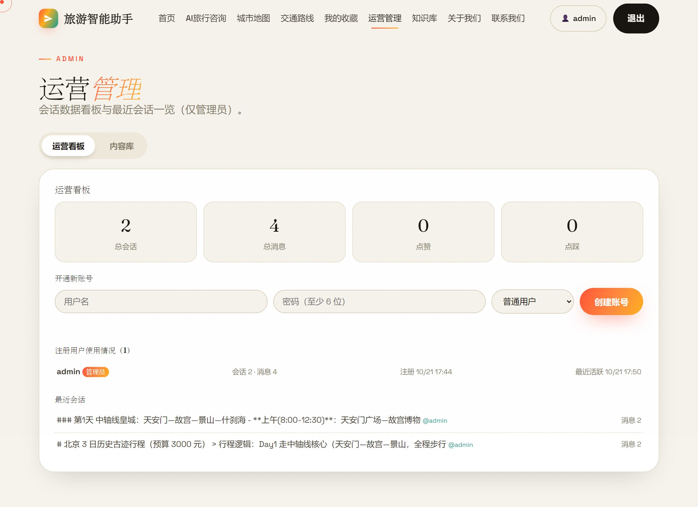
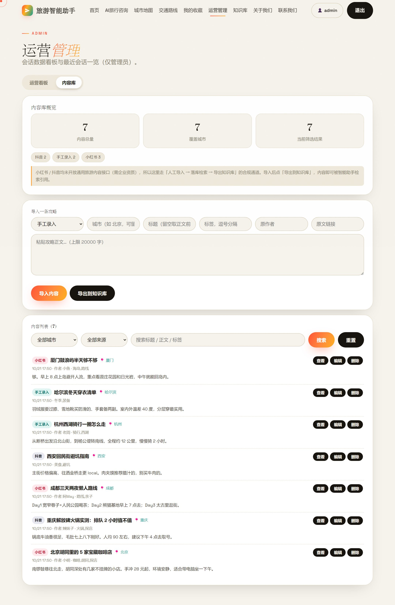

# 🧳 旅游智能助手 Travel Copilot

> **一句话**：用 LangGraph 编排「1 个调度中心 + 5 位专家」的多 Agent 协作图，配合本地攻略库 RAG 检索，把「帮我规划北京 3 天行程，预算 3000」变成一份带预算表、天气、交通路线和预约提醒的可执行攻略。

[**▶ 在线体验**](https://ddan11-travel-copilot.ms.show) ｜ [界面截图](#-界面) ｜ [系统架构](#-架构) ｜ [工程质量](#-工程质量) ｜ [快速开始](#-本地运行)


---

## 📸 界面

**AI 旅行咨询**：左侧是会话历史与顾问团队，右侧实时展示「谁被调度、为什么被调度」的协作轨迹，以及深度思考过程。



**城市景点地图**：355 城 / 1558 个景点，按拼音首字母分组，支持驾车 / 步行 / 公交路线与自然语言筛选。



**运营管理**：会话与消息统计、各专家调用分布；内容库支持导入站外攻略、筛选、编辑、导出到知识库。

<table>
<tr>
<td width="50%"></td>
<td width="50%"></td>
</tr>
</table>

---

## 🏗 架构

```
                        浏览器（原生 JS，无框架）
              ┌──────────────────────────────────────┐
              │ 静态站 index/chat/map/admin …         │
              │ SSE 流式渲染 · 协作轨迹 · 思考过程面板  │
              └──────────────────┬───────────────────┘
                                 │  X-Auth-Token（不用 Authorization: Bearer，见下文）
              ┌──────────────────▼───────────────────┐
              │ FastAPI  app/main.py                 │
              │  /api/chat/stream   SSE 流式问答      │
              │  /api/auth          注册 / 登录 / 改密 │
              │  /api/notes         外部内容库        │
              │  /api/admin         运营看板 / 开通账号│
              │  限流中间件：匿名 / 登录 / 全局三层     │
              └──────────────────┬───────────────────┘
                                 │
              ┌──────────────────▼───────────────────┐
              │ LangGraph StateGraph                 │
              │                                      │
              │  supervisor ──Command(goto=专家)──┐   │
              │       ▲                          │   │
              │       └──专家完成任务后回跳───────┘   │
              │                                      │
              │  行程规划师 / 景点顾问 / 美食顾问      │
              │  数据分析师 / 旅行咨询师               │
              │  max_agent_steps 兜底，防无限循环      │
              └──────────────────┬───────────────────┘
                                 │ 工具调用
        ┌────────────────┬───────┴────────┬────────────────┐
        ▼                ▼                ▼                ▼
   RAG 检索          天气查询          预算计算         知识库导出
 BGE + FAISS      open-meteo        纯函数，可单测       Markdown
        │
        └──────────────┬──────────────────────────────────┘
                       ▼
        ┌──────────────────────────────────┐
        │ SQLite  $DATA_DIR/travel.db (WAL) │
        │ users / sessions / messages /     │
        │ feedback / favorites / notes …    │
        └──────────────────────────────────┘
```

**几个设计取舍**

| 决策 | 原因 |
| --- | --- |
| 前端用原生 JS，不上框架 | 全部 HTML / JS / CSS **gzip 后合计 92KB**（不含图片），首屏无 hydration 开销；也避免为 6 个页面引入构建链 |
| 用 `Command(goto=…)` 而非固定边 | 专家可以在执行中把控制权交回调度中心，实现「景点顾问做完发现预算超了，转数据分析师重算」 |
| RAG 按 Markdown 标题切，不按字数切 | 知识库本来就是结构化文档，标题就是语义边界；硬切会把「预算 + 行程 + 避坑」揉成一块，导致 top-1 检索错。块首再补 `【城市】` 前缀，否则六个城市的「## 必游景点」在向量空间里混成一团 |
| 向量召回后再做一次词法重排 | `bge-small-zh` 会把「预算参考」排到「故宫」前面（两者都含「门票」）。用 **IDF 加权的 2-gram 覆盖率**把实体名（故宫、宽窄巷子、兵马俑）的分量提上来，零额外依赖、零额外延迟 |
| 城市是硬约束 | 「上海去苏州怎么走」不做城市过滤时 top-1 会返回北京颐和园——向量被「怎么走」这种通用短语带偏。旅游场景里城市不是软偏好，是硬条件 |
| 专家失败降级，不击穿链路 | 任一专家抛异常都只标记该专家失败，其余专家照常汇总并显式提示；失败专家也算「已处理」，否则调度中心会反复路由到它，直到耗尽轮次 |
| 重型依赖全部延迟导入 | `torch` / `sentence-transformers` 只在真正建索引时加载，冷启动不被拖慢，镜像也能瘦身 |
| 状态存单文件 SQLite | 全站状态只有一个目录，容器挂一个持久化卷即可；换 Postgres 只需改 `app/store.py` |
| 前端统一 `X-Auth-Token` | 部分平台边缘 WAF 会拦 `Authorization: Bearer`，详见「部署加固」 |

---

## ✨ 功能

- 🤝 **多 Agent 协作** — 调度中心智能路由，5 位专家按需接力；聊天页实时展示**协作轨迹**（谁被调度、为什么、是否完成），可展开每位顾问的**思考过程**
- 🧠 **深度思考** — 基于 DeepSeek Reasoner，回答前先推理
- 📚 **攻略知识库** — RAG 检索（BGE-small-zh + FAISS），管理员可上传自己的攻略文档并重建索引
- 📏 **边界可见** — 攻略库覆盖哪几个城市、这次回答是「攻略库事实」还是「通用建议」，在界面上和回答里都标清楚（见下节）
- 🌦️ **真实天气** — 接入 open-meteo 实时预报，覆盖 20 个热门城市
- 💬 **会话管理** — 历史会话列表、恢复追问、⭐收藏、👍/👎反馈、一键导出 Markdown
- 🧳 **行程工作台** — 新建行程（目的地 / 出发日期 / 天数 / 预算）后：模型结合攻略库生成**按天安排**、按目的地气候与天数自动配**行前装备清单**、出发前 16 天内给出**行程期间天气 + 出行建议**；条目可逐条勾选，进度与倒计时实时更新（`/api/trips`，数据按用户隔离）
- 🗺️ **地图与路线** — **355 城 / 1558 个景点**（含 44 城的美食街与夜市），驾车 / 步行 / 公交路线规划，支持自然语言筛选
- ✏️ **景点可自维护** — 地图页可自行增删景点，本地保存、可一键恢复默认，自定义景点同样参与筛选
- 📊 **运营看板** — 会话 / 消息统计、各专家调用分布、**token 用量与成本估算**（按模型分档计价）、注册用户使用情况（仅管理员）
- 📥 **内容库** — 站外攻略（小红书 / 抖音 / 手工）合规导入、检索、一键导出进知识库

---

## 📏 能力边界：地图 355 城 ≠ 攻略库 6 城

项目里有**三套覆盖范围完全不同**的城市数据，混为一谈就会给出「看着精确、其实没依据」的回答：

| 数据 | 覆盖 | 有什么 | 没有什么 |
| --- | --- | --- | --- |
| 地图 `geo-data.js` | **355 城 / 1558 个景点**（含 44 城的美食街与夜市） | 坐标、分类，可做定位与驾车/步行/公交路线 | **没有攻略正文**——查不到门票、开放时间、玩法 |
| 攻略库 `knowledge_base/*.md` | **6 城**：北京 · 上海 · 成都 · 杭州 · 西安 · 重庆 | 门票、开放时间、交通、玩法、预算、避坑，是 RAG 的**唯一事实来源** | 其余城市均未收录 |
| 天气 `open-meteo` | **20 个热门城市** | 实时预报与穿衣建议 | 其余城市走降级提示 |

### 问到没覆盖的城市，系统会怎么做

不是「静默退化成通用建议」，而是四层显式声明：

1. **检索层直接返回空** — 用户点名的城市全部不在攻略库内时，`retriever.search()` 不返回任何块。
   此前会返回北京的段落：「有什么好玩的」这种通用短语把向量相似度拉到 0.55 阈值之上，
   模型于是拿北京资料回答哈尔滨，**比答不上来更糟**。
2. **提示词层注入边界** — `build_prompt()` 在知识库资料**之前**插入「知识库覆盖边界」，
   要求专家在相关段落开头写明「⚠️ XX 暂无本地攻略库，以下为通用建议」，且不得编造门票、开放时间等易变信息。
3. **回答末尾固定脚注** — 汇总阶段可能压缩正文，脚注不会：
   `📍 知识库覆盖提示：本地攻略库目前覆盖 北京、上海…，涉及「哈尔滨」的部分来自通用知识，未经攻略库校验。`
4. **界面提示** — 输入框上方常驻「攻略库覆盖 6 城」；该城市无资料时，气泡底部再出一条黄色提示条。

同步接口 `/api/chat` 的响应、SSE 的 `coverage` 事件、公开接口 `GET /api/knowledge/coverage`
都会带出 `{asked, covered, uncovered, kb_cities, map_cities}`，调用方不必靠猜。

### 怎么扩到更多城市

把 `哈尔滨.md` 放进 `knowledge_base/`（格式同现有 6 篇），点「重建索引」即可——
覆盖城市清单由目录实时推导，**不需要改任何代码**，前端提示与后端边界判定会一起生效。

> 演示时建议主动说这一句：**「地图覆盖 355 城，攻略库目前精编了 6 城；问其他城市我会明确告诉你这是通用建议。」**
> 主动划边界比被问出来可信得多，也避免把「模型常识」当成「攻略库事实」展示。

---

## ✅ 工程质量

| 项目 | 现状 |
| --- | --- |
| 后端单元 / 接口测试 | **175 项 pytest**（认证、双鉴权头、Token 过期、改密踢线、RBAC、分页、部分更新、限流、预算工具、会话标题清洗、依赖清单对齐、**专家级容错、检索排序、提示词注入防护、token 计量、知识库覆盖边界、行程工作台、索引过期检测**） |
| 脚本化回归 | **477 项**：接口冒烟 85 · 存储层 156 · 城市数据 67 · 前端 DOM 47 · 地图 24 · Markdown 17 · 文案一致性 24 · **行程工作台 18** · **RAG 检索质量 39（含 6 条越界门禁）** |
| 检索质量（有指标） | 39 条人工标注 query：Recall@1 / @3 **100%**，MRR **0.987**，City@1 **100%**；其中 6 条**越界 query**（哈尔滨/三亚/拉萨…）必须**零泄漏**（低于阈值即失败） |
| 端到端回答质量 | 6 条真实链路：**6/6 通过**，平均 **18.6s**，合计 44.7K tokens ≈ **¥0.22**（锚点命中、关键信息覆盖、内部信息泄漏、延迟预算；`make eval-e2e`，**消耗真实额度，不进 CI**） |
| 测试覆盖率 | **69%**（`pytest --cov=app`，CI 门槛 55%） |
| 静态检查 | `ruff check` **0 错误**，`ruff format` 已格式化 |
| CI | GitHub Actions：后端（ruff + pytest + 覆盖率门槛）+ 前端（jsdom 五套脚本）双 job |
| 一键回归 | `bash scripts/check_all.sh`（或 `make test-all`），任一失败即非 0 退出 |
| 提交前钩子 | `.pre-commit-config.yaml`：ruff、格式检查、大文件拦截；push 前跑 pytest |

```bash
bash scripts/check_all.sh          # 全量 10 组，约 3 分钟（含 RAG 检索质量）
bash scripts/check_all.sh --fast   # 跳过最慢的存储层与检索评估
make eval-e2e                      # 端到端回答质量（会花几毛钱 API 额度）
```

> 回归测试全部**离线、零成本**：`LLM_PROVIDER=mock`，临时 `DATA_DIR`，不消耗真实 API 额度、不污染本地数据。
> 只有 `make eval-e2e` 会真的调模型——它测的是「答得对不对」，mock 模式测不了这件事，所以单独隔离、不进 CI。

**AI 应用该有的可观测性**

| 指标 | 落地方式 |
| --- | --- |
| token 用量 | 每次 LLM 调用（路由 / 专家 / 汇总）都落 `llm_usage` 表，按 agent、按模型两个维度聚合 |
| 成本估算 | 按模型分档计价（reasoner 4/16 元每百万，chat 2/8 元每百万），避免用单一单价算出一个「看着精确其实错」的数 |
| 检索质量 | `scripts/eval_rag.py` 把 Recall@1/@3、MRR、城市命中率钉成数字，改切分或重排后能立刻看出是变好还是变差；另有 **6 条越界 query 门禁**，知识库没有的城市必须返回空，泄漏一条即失败 |
| 边界可见 | 覆盖判定（问了哪些城市 / 哪些有攻略库）随 `/api/chat` 响应与 SSE `coverage` 事件下发；回答正文由专家标注「通用建议」，末尾再补固定脚注——不靠模型自觉 |
| 降级可见 | 单个专家失败不再击穿整条链路：其余专家照常汇总，前端协作轨迹把失败的那一位标红，回答末尾显式提示「有 N 位专家未能完成分析」 |
| 健康检查不撒谎 | `/health` 区分 `index_ready`（索引文件在）与 `rag_ready`（模型+索引真的加载成功）。重型依赖是延迟导入的，容器里 torch 装失败时进程照样起得来——只报前者会得出「一切正常」的错误结论。失败原因通过 `rag_error` 直接暴露 |

> ⚠️ 关于 RAG 的 100%：这 33 条 query 是在**当前语料**上写的，用来做**回归基线**——它保证「改切分、改重排不会把已经对的东西弄坏」，不等于泛化能力。
> 语料扩到几十个城市后，这个集合必须重新标注，否则就是在拿训练集当测试集。
> 切分与重排的设计动机也来自真实错误：按固定字数切会把「预算参考 + 行程 + 避坑」揉进同一块，
> 问「故宫门票多少钱」时 top-1 是预算段而不是故宫段——这条已写进 `tests/test_rag_split.py`。

---

## 🚀 本地运行

```bash
# 1. 依赖
python -m venv .venv
.venv/Scripts/pip install -r requirements.txt          # Windows
# source .venv/bin/activate && pip install -r requirements.txt   # macOS / Linux

# 2. 配置（复制模板后填入自己的 Key）
cp .env.example .env

# 3. 构建知识库索引（首次会下载 BGE 向量模型）
python scripts/build_kb.py

# 4. 启动（官网静态站挂在 /，API 在 /api）
python -m uvicorn app.main:app --host 127.0.0.1 --port 7860
```

访问 <http://127.0.0.1:7860/>。默认管理员 `admin` / `admin123`（用 `ADMIN_USERNAME` / `ADMIN_PASSWORD` 覆盖，**上线前务必改成强密码**）。

> 若本机设置了 HTTP 代理，用 curl 访问本地服务时需加 `--noproxy '*'`。
> Windows 下没有 `make` 时，直接执行 `Makefile` 里对应行的命令即可。

### Docker

```bash
docker compose up -d          # 单服务，监听 7860，数据挂 ./data
```

### 发布到沙箱平台（`deploy/`）

```bash
python scripts/build_deploy.py    # 生成自包含发布包（含索引与 BGE 模型缓存）
```

发布时**必须**用 `installCmd="bash install.sh"`，不要直接写 `pip install -r requirements.txt`。
`install.sh` 会在装完依赖后卸掉基座镜像预装的 CUDA 版 `torchaudio` / `torchvision`——
它们与包里的 CPU 版 `torch` C 扩展不匹配，会让 `sentence-transformers` 导入即失败，
而进程照样起得来，表现为「网站能打开、一问就降级」。排查入口是 `/health` 的
`rag_state` / `rag_error` / `rag_imports` 三个字段。

---

## 🔑 改管理员密码

管理员账号只在**首次启动**时创建，之后改 `.env` 不会覆盖已存在的密码：

```bash
python scripts/admin_password.py --local  <新密码>              # 本地 SQLite（data/travel.db）
python scripts/admin_password.py --remote <站点地址> <新密码>    # 已发布站点（走改密接口）
```

线上模式省略旧密码时会自动从 `deploy/.env` 读取，改完还会用新密码复核登录。
改密会**吊销该用户所有已签发的 Token**（强制重新登录）。

---

## 🗄️ 数据存储

所有状态（用户、会话、消息、反馈、收藏、运营统计、外部内容库）统一存在 SQLite：

```
$DATA_DIR/travel.db      # 单文件，跟随持久化卷；WAL 模式
```

- 用标准库 `sqlite3`，**不引入任何新依赖**，镜像体积与构建时间不受影响；
- 从早期的 JSON / JSONL 版本升级时**首次启动自动迁移**，日志打印迁移条数，
  旧文件改名 `*.imported` 留档，靠 `meta.json_migrated` 打标保证幂等；迁移失败只记日志、不阻塞启动；
- 会话 / 收藏列表按需查询，不再全量加载进内存；计数即时落库。

### 攻略库更新怎么同步到持久化卷

内置攻略在镜像里，实际读取的是持久化卷 `$KB_DIR`。**两处都可能让「更新了但线上还是旧的」**：

1. `start.sh` 启动时**按内容比较**（`cmp -s`）把镜像里的 `knowledge_base/*.md` 覆盖到卷上——
   早期用 `cp -n`（已存在就跳过），导致镜像里的攻略更新永远进不去；
2. 索引落盘时写一份 `meta.json`（`{文件名: mtime}`），启动时 `index_stale()` 比对签名，
   落后就自动重建。**只判断「索引文件在不在」是不够的**：文件在、正文变了，索引照样是旧的。

`/health` 的 `index_stale` 字段直接反映这件事，不用登录后台就能看出线上是不是在用旧攻略。

---

## 📥 外部内容库（小红书 / 抖音攻略导入）

**先说结论：这两家都没有面向第三方的通用内容接口，所以本项目不做自动抓取。**

- 小红书开放平台、抖音开放平台都要求**企业营业执照 + 企业认证**，
  开放的接口面向订单 / 商品 / 广告 / 已授权用户数据，**不提供旅游内容与笔记检索**；
- 绕过反爬直接抓取违反其服务协议，也会让站点承担合规风险。

因此这里提供的是一条**合规的导入通道**：管理员把站外看到的攻略正文粘贴进来，
落库后可检索，并能一键导出成知识库文档参与 RAG，真正进入多 Agent 的回答链路。

**入口在页面上**：登录管理员 → 顶部「运营管理」→「内容库」标签页。
可粘贴导入、按城市 / 来源 / 关键词筛选、分页浏览、查看全文、就地编辑、删除，以及一键「导出到知识库」。

| 接口 | 权限 | 说明 |
| --- | --- | --- |
| `GET /api/notes` | 登录 | 列表，支持 `?city=` `?source=` `?q=`、`?limit=` 与 `?offset=` 分页 |
| `GET /api/notes/stats` | 登录 | 概览：总量、按来源分布、覆盖城市数，以及**城市明细** |
| `GET /api/notes/{id}` | 登录 | 详情 |
| `POST /api/notes` | 管理员 | 导入一条（`source` 取 `xiaohongshu` / `douyin` / `manual` / `other`） |
| `PUT /api/notes/{id}` | 管理员 | 局部更新，只传要改的字段 |
| `DELETE /api/notes/{id}` | 管理员 | 删除 |
| `POST /api/notes/export-to-kb` | 管理员 | 按城市导出为 `知识库/外部攻略-*.md` 并重建索引 |

> **分页总数放在 `X-Total-Count` 响应头里**，返回体仍然是数组 ——
> 这样加分页不需要改动任何已有调用方的返回结构。
>
> 列表排序是 `created_at DESC, id DESC`。加 `id` 作次级键是必须的：
> 批量导入时多条记录的 `created_at` 可能撞在同一毫秒，只按时间排序会让翻页出现重复或漏项。
>
> 导出只清理自己生成的 `外部攻略-*.md`，不会动用户自己上传的文档。
> 重建索引需要 `sentence-transformers` / `faiss`，缺失时明确报错而不是静默失败。

---

## 🔒 权限模型

| 接口 | 权限 |
| --- | --- |
| `/api/config` | 公开（仅下发高德 JS Key 等**本就属于浏览器**的配置） |
| `/api/chat*`、`/api/agents` | 匿名可用（受匿名限流；会话历史相关需登录） |
| `/api/favorites*` | 需登录，且仅能读写**自己**的收藏 |
| `/api/knowledge*` | 需**管理员**（列表 / 上传 / 删除 / 重建索引） |
| `/api/notes` 读接口 | 需登录（列表 / 概览 / 详情） |
| `/api/notes` 写接口 | 需**管理员**（导入 / 编辑 / 删除 / 导出到知识库） |
| `/api/admin*` | 需**管理员**（含开通账号 `/api/admin/users`） |

密码用 `pbkdf2_hmac('sha256', …)` + 每用户随机盐，10 万次迭代；密码最短 6 位，前后端同一套校验。
Token 默认 7 天过期（`TOKEN_TTL_SECONDS`），改密即吊销该用户全部 Token。

---

## 🛡️ 公网部署加固

真实 LLM 额度一旦公网暴露就容易被刷，因此默认做了三层限流（全部可在 `.env` 中调整）：

| 开关 | 默认 | 作用 |
| --- | --- | --- |
| `ALLOW_REGISTRATION` | `true` | 任何人可自助注册。设为 `false` 则关闭注册，新账号只能由管理员开通 |
| `RATE_LIMIT_ANONYMOUS_PER_MINUTE` | `2` | 匿名访客每个 IP 每分钟的对话上限 |
| `RATE_LIMIT_PER_MINUTE` | `6` | 登录用户每个 IP 每分钟的对话上限 |
| `RATE_LIMIT_GLOBAL_PER_MINUTE` | `20` | **全局硬上限**：即使伪造 `X-Forwarded-For` 轮换 IP 也绕不过 |
| `AUTH_RATE_LIMIT_PER_MINUTE` | `10` | 登录 / 注册尝试上限，防暴力破解 |

管理员可用 `GET /api/admin/ratelimit` 查看当前配置与各窗口占用情况。

> ⚠️ 开放注册时，**限流就是唯一的额度防线**。要彻底收紧，把 `ALLOW_REGISTRATION` 设为 `false`。

### ⚠️ 鉴权头：用 `X-Auth-Token`，不要用 `Authorization: Bearer`

**部分平台的边缘 WAF 会把任何带 `Authorization: Bearer …` 的请求当成「SDK Token 直连」直接 403**，
与 token 内容无关，应用层根本收不到请求。实测魔搭创空间（`*.ms.show`）就是如此：

```
Authorization: Bearer <token>   ->  403（平台 WAF 拦截）
X-Auth-Token: <token>           ->  正常到达应用
```

因此前端 `app.js` 统一用 `X-Auth-Token`。后端 `_extract_token()` **两种头都认**，
所以换到别的平台不需要改回来，用 `Authorization: Bearer` 调 API 也照常工作。

> 如果你的站点出现「能登录，但收藏 / 我的会话 / 运营管理全部报错」，
> 优先检查是不是被平台 WAF 拦了 —— 抓包看响应体里有没有平台的 `Code` 字段。

### 🔑 高德 Key 走运行时下发，不写死在前端

地图页的 JS API Key 与安全密钥由 `GET /api/config` 下发，前端源码里没有硬编码。

这两个值**本来就必须发送到浏览器**（JS API 2.0 强制要求在建图前注入
`window._AMapSecurityConfig`），所以它们不是服务端密钥，真正的访问控制靠
**高德控制台的域名白名单**。做成运行时配置的意义是：自部署者能换成自己的 Key，
而不是共用项目的额度；未配置时地图页会直接显示排查提示，而不是一片空白。

---

## 📁 目录结构

```
app/
  agents/       LangGraph 多 Agent 协作图、调度中心与 5 位专家
  api/          对话 / 认证 / 收藏 / 行程 / 知识库 / 内容库 / 运营管理接口（含鉴权依赖）
  rag/          FAISS 索引构建与检索、覆盖边界判定（coverage.py）
  tools/        天气（含预报与出行建议）、预算、知识库检索、行前装备（packing.py）
  db.py         SQLite 连接、建表与旧 JSON 数据一次性迁移
  store.py      会话 / 收藏 / 用户 / 统计的持久化
  notes.py      外部内容库：导入、检索、导出到知识库
  trips.py      行程工作台：行程 CRUD、勾选进度、装备清单、按天行程生成
frontend/static/  官网与功能页静态站点（由 FastAPI 挂载于 /）
  assets/img/     本地配图（9 张渐进式 JPEG，无外部图床依赖）
  assets/js/      app.js（交互与地图模板）/ geo-data.js（355 城地理数据）/ main.js
knowledge_base/   内置攻略文档（北京 / 上海 / 成都 / 杭州 / 西安 / 重庆 + 行前准备与装备）
scripts/          索引构建、部署打包与自测脚本
tests/            pytest 用例
docs/screenshots/ README 截图
```

---

## 📝 变更记录

见 [CHANGELOG.md](./CHANGELOG.md)。

## 📄 License

[MIT](./LICENSE)
