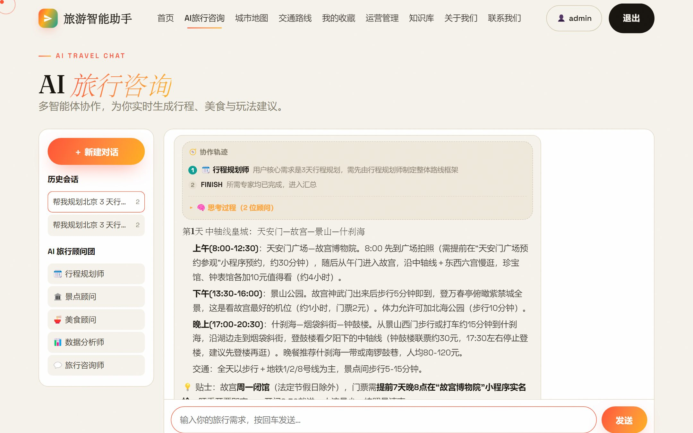
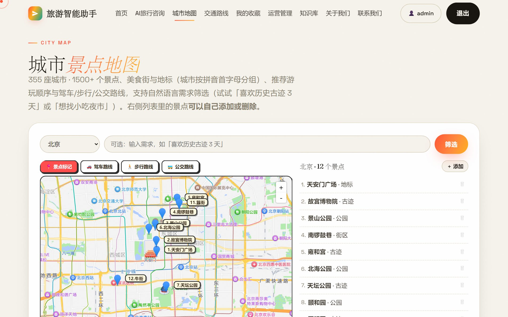
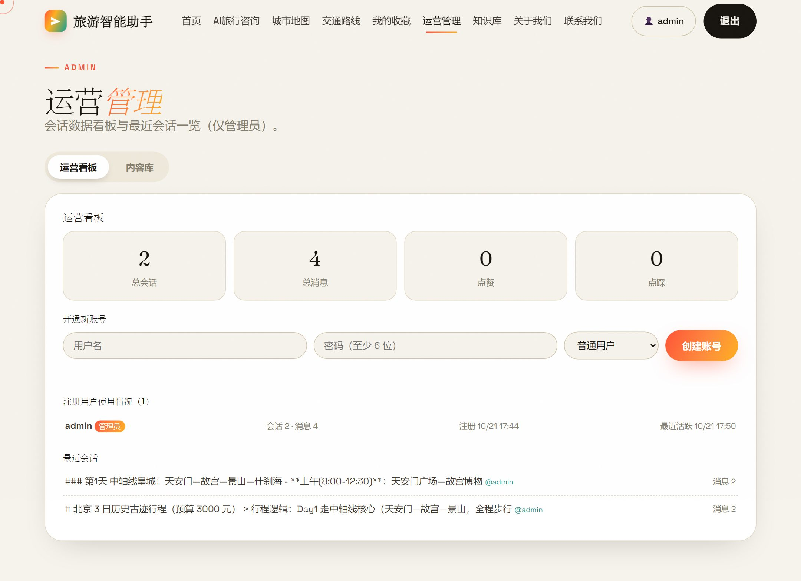
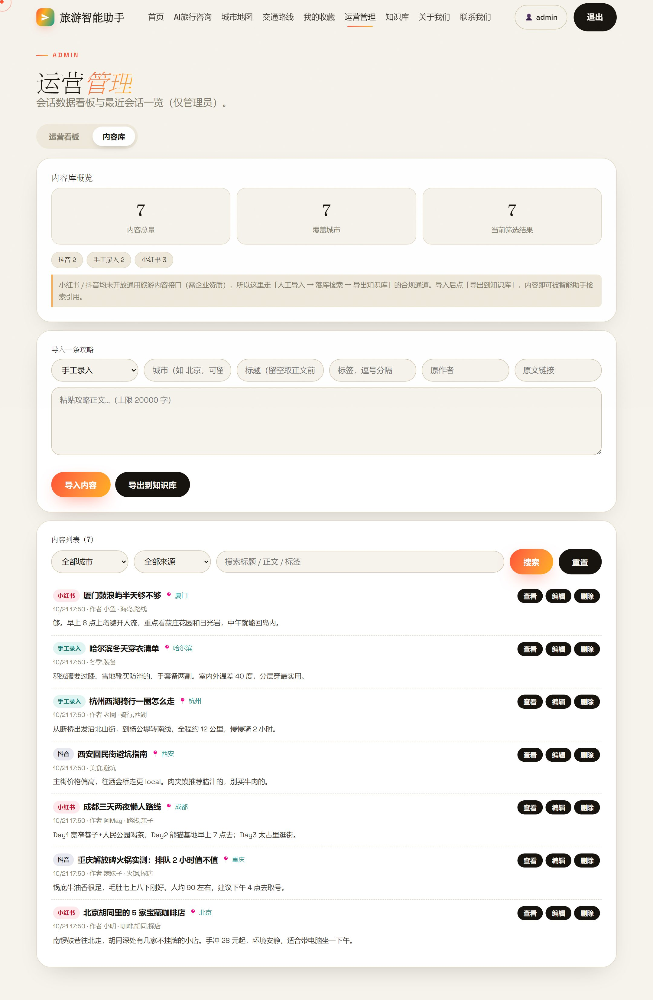

# 🧳 个人智能旅游行程规划系统

> **个人独立全栈项目**：基于 SpringBoot 的个人智能旅游行程规划系统
>
> SpringBoot 主后端 + Python AI 服务双进程，认证、行程、记账、模板、分享、导出全部自研。
>
> **主体是 SpringBoot（Java 17）**：唯一对外入口，负责认证鉴权、行程与条目、记账、模板、分享、导出、天气与前端托管；
> Python FastAPI 只作为内网 AI 服务（`127.0.0.1:7861`），由 SpringBoot 反向代理，不暴露公网。
> 架构与设计决策见 [`docs/architecture.md`](docs/architecture.md)，演示脚本见 [`docs/demo.md`](docs/demo.md)。

> **一句话**：用 LangGraph 编排「1 个调度中心 + 5 位专家」的多 Agent 协作图，配合本地攻略库 RAG 检索，把「帮我规划北京 3 天行程，预算 3000」变成一份带预算表、天气、交通路线和预约提醒的可执行攻略。

[**▶ 在线体验**](https://ddan11-travel-copilot.ms.show) ｜ [界面截图](#-界面) ｜ [系统架构](#-架构) ｜ [工程质量](#-工程质量) ｜ [快速开始](#-本地运行)

> 线上跑的就是这套双进程版本（SpringBoot 对外 + Python AI 内网），
> `GET /api/health` 会返回 `{"server":"spring-boot"}`。
> 站点是公开的，直接注册即可用；管理员密码由平台的 `ADMIN_PASSWORD` secret 注入，不在仓库里。
> 旧的 Python 单进程版账号（存在 SQLite、pbkdf2 哈希）无法迁移，需要重新注册。


---

## 📸 界面

**AI 旅行咨询**：左侧是会话历史与顾问团队，右侧实时展示「谁被调度、为什么被调度」的协作轨迹，以及深度思考过程。



**城市景点地图**：355 城 / 1558 个景点，按拼音首字母分组，支持驾车 / 步行 / 公交路线与自然语言筛选。



**运营管理**：会话与消息统计、各专家调用分布；内容库支持导入站外攻略、筛选、编辑、导出到知识库。

<table>
<tr>
<td width="50%"></td>
<td width="50%"></td>
</tr>
</table>

---

## 🏗 架构

双后端：**SpringBoot 是唯一对外入口与业务主后端**，Python 只保留「AI 能力服务」这一件事。

> SpringBoot 侧的包结构、过滤器链、JPA 与事务、统一异常、配置与反向代理实现，见
> [`docs/architecture.md` 第 4 节](docs/architecture.md#4-springboot-实现要点)。

```
                        浏览器（原生 JS，无框架）
              ┌──────────────────────────────────────┐
              │ 静态站 index/chat/map/trips/admin …   │
              │ SSE 流式渲染 · 协作轨迹 · 行程工作台   │
              └──────────────────┬───────────────────┘
                                 │  X-Auth-Token（不用 Authorization: Bearer，见下文）
              ┌──────────────────▼───────────────────┐
              │ SpringBoot 3.2   server/  ← 唯一入口  │
              │  认证 JWT + BCrypt · 行程 · 记账       │
              │  模板库 · 分享 · 导出 ics/打印版        │
              │  天气 · 装备清单 · 355 城坐标           │
              │  H2 文件库 / MySQL（profile 切换）      │
              │  AiProxy 反代 /api/chat /api/knowledge │
              └──────────────────┬───────────────────┘
                                 │  X-Internal-Secret + X-User-Name（内部信任头）
              ┌──────────────────▼───────────────────┐
              │ Python FastAPI  app/  （AI 能力服务）  │
              │  /api/ai/plan · /api/ai/revise        │
              │  /api/chat/stream SSE · 限流           │
              │  /api/notes 内容库 · /api/admin 看板    │
              └──────────────────┬───────────────────┘
                                 │
              ┌──────────────────▼───────────────────┐
              │ LangGraph StateGraph                 │
              │                                      │
              │  supervisor ──Command(goto=专家)──┐   │
              │       ▲                          │   │
              │       └──专家完成任务后回跳───────┘   │
              │                                      │
              │  行程规划师 / 景点顾问 / 美食顾问      │
              │  数据分析师 / 旅行咨询师               │
              │  max_agent_steps 兜底，防无限循环      │
              └──────────────────┬───────────────────┘
                                 │ 工具调用
        ┌────────────────┬───────┴────────┬────────────────┐
        ▼                ▼                ▼                ▼
   RAG 检索          天气查询          预算计算         知识库导出
 BGE + FAISS      open-meteo        纯函数，可单测       Markdown
        │
        └──────────────┬──────────────────────────────────┘
                       ▼
        ┌──────────────────────────────────┐
        │ SQLite  $DATA_DIR/travel.db (WAL) │
        │ 会话 / 消息 / 反馈 / 收藏 / 内容库 │
        └──────────────────────────────────┘
```

**为什么是两个后端**（不是为了「看起来复杂」，每条都有具体原因）

| 边界 | 规则 |
| --- | --- |
| 只有一个对外入口 | 公网只暴露 SpringBoot。Python 服务不直接对外，`/api/chat/**`、`/api/knowledge/**`、`/api/notes/**`、`/api/admin/**` 由 `AiProxyController` 反代过去 |
| 身份只解一次 | SpringBoot 校验 JWT 后，用 `X-Internal-Secret` + `X-User-Name` + `X-User-Role` 把身份转给 Python。密钥两侧共享，**留空即关闭**（不给默认值开后门） |
| 行程数据只有一份真相 | 行程 / 条目 / 花费全在 SpringBoot 侧（JPA + H2/MySQL）。Python 的 `/api/ai/plan`、`/api/ai/revise` 是**无状态**的：只返回结构化安排，不落库 |
| AI 挂了主流程还能用 | 行程、记账、模板、导出、天气全部不依赖 Python；只有「AI 生成 / 改行程」会降级成「可手动添加」 |

**几个设计取舍**

| 决策 | 原因 |
| --- | --- |
| 前端以原生 JS 为主，不做构建链 | 11 个页面是手写 HTML / CSS / JS，首屏无 hydration、无打包步骤；只有 `spots.html`（Vue 3 + Element Plus）与 `trips.html`（ECharts）两个页面引第三方 vendor。全部 HTML / JS / CSS **gzip 后合计约 855KB**（不含图片，含字体托管 fonts.css；woff2 本体不计入），**剔除 `assets/vendor/` 后约 151KB**（阶段五新增 tokens.css 与各页字体 preload 链接后的实测值） |
| 用 `Command(goto=…)` 而非固定边 | 专家可以在执行中把控制权交回调度中心，实现「景点顾问做完发现预算超了，转数据分析师重算」 |
| RAG 按 Markdown 标题切，不按字数切 | 知识库本来就是结构化文档，标题就是语义边界；硬切会把「预算 + 行程 + 避坑」揉成一块，导致 top-1 检索错。块首再补 `【城市】` 前缀，否则六个城市的「## 必游景点」在向量空间里混成一团 |
| 向量召回后再做一次词法重排 | `bge-small-zh` 会把「预算参考」排到「故宫」前面（两者都含「门票」）。用 **IDF 加权的 2-gram 覆盖率**把实体名（故宫、宽窄巷子、兵马俑）的分量提上来，零额外依赖、零额外延迟 |
| 城市是硬约束 | 「上海去苏州怎么走」不做城市过滤时 top-1 会返回北京颐和园——向量被「怎么走」这种通用口语带偏。旅游场景里城市不是软偏好，是硬条件 |
| 专家失败降级，不击穿链路 | 任一专家抛异常都只标记该专家失败，其余专家照常汇总并显式提示；失败专家也算「已处理」，否则调度中心会反复路由到它，直到耗尽轮次 |
| 重型依赖全部延迟导入 | `torch` / `sentence-transformers` 只在真正建索引时加载，冷启动不被拖慢，镜像也能瘦身 |
| 记账用 `BigDecimal`，分类是固定枚举 | 金额用浮点算会漂（0.1+0.2）；分类开放自由输入的话，一周后就会出现「吃」「吃饭」「餐饮」三套口径，统计页直接失去意义 |
| 导出 PDF 走「打印版 HTML」而不是服务端生成 | 服务端生成 PDF 要嵌中文字体（十几 MB），还容易在不同环境变方块字。交给浏览器 `Ctrl+P` 反而稳定 |
| 改密用「会话世代」而不是时间戳 | JWT 的 `iat` 只到秒，「改密」与「改密后登录」常在同一秒；用时间比较就必须留容差窗口，而那个窗口正好是漏洞 |
| 前端统一 `X-Auth-Token` | 部分平台边缘 WAF 会拦 `Authorization: Bearer`，详见「部署加固」 |

---

## ✨ 功能

- 🤝 **多 Agent 协作** — 调度中心智能路由，5 位专家按需接力；聊天页实时展示**协作轨迹**（谁被调度、为什么、是否完成），可展开每位顾问的**思考过程**；回答底部标出「**几位顾问、几步推理**」，耗时放悬停提示里（后端 `elapsed_ms` / `agent_calls`，之前一直没人读）
- 🧠 **深度思考** — 基于 DeepSeek Reasoner，回答前先推理
- 📚 **攻略知识库** — RAG 检索（BGE-small-zh + FAISS），管理员可上传自己的攻略文档并重建索引
- 📏 **边界可见** — 攻略库覆盖哪几个城市、这次回答是「攻略库事实」还是「通用建议」，在界面上和回答里都标清楚（见下节）
- 🌦️ **真实天气** — 接入 open-meteo 实时预报；行程工作台里的天气覆盖 **355 城**（读地图那份坐标），聊天内的天气工具仍限 20 个热门城市
- 💬 **会话管理** — 历史会话列表、恢复追问、⭐收藏、👍/👎反馈、一键导出 Markdown
- 🧳 **行程工作台** — 新建行程（目的地 / 出发日期 / 天数 / 预算）后：模型结合攻略库生成**按天安排**、按目的地气候与天数自动配**行前装备清单**、出发前 16 天内给出**行程期间天气 + 出行建议**；条目可逐条勾选，进度与倒计时实时更新（`/api/trips`，数据按用户隔离）
- 🧪 **开箱即用的示例行程** — 还没有行程时，空状态里点一下就能载入一份「北京 3 天」：景点名取自地图数据（真实名称与分类），不调 AI、不联网，秒出；用来快速看清工作台能做什么，随时可删（`POST /api/trips/sample`）
- 💰 **预算记账** — 按 交通/住宿/餐饮/门票/购物/其他 六类记每一笔（可挂到某一天），详情页实时显示已花 / 剩余 / 进度条；超预算时提示压哪块，未设预算时不硬算百分比
- 📊 **费用图表** — 详情页用 ECharts 画两张图：**分类占比**（环形）与**按天花费**（柱状），一眼看出钱花在哪天、哪一类
- 🏛️ **景点库**（`spots.html`）— 独立于攻略正文的结构化景点表：**346 城 / 8274 个景点**，带分类、标签、门票、建议时长、开放时间与坐标；支持「城市 + 关键词 + 分类 + 标签 + 是否免费 + 时长上限」组合筛选，一键加入行程的某一天
- 🎯 **偏好标签匹配** — 在个人偏好里选最多 8 个标签（室内 / 室外 / 免费 / 亲子 / 拍照 / 历史 / 夜游 / 少走路），推荐按「与景点标签的交集大小」排序；这就是本课题里「智能」的全部含义，不做协同过滤
- 📖 **图文游记** — 行程结束后在详情页直接写游记，可配图（存 `$DATA_DIR/uploads`，单张 ≤5MB），按行程归属、别人看不到
- ⚠️ **排期冲突提示** — 同一天同一时段安排两项、条目超出行程天数、同日重复、单日超 6 项时给出黄色提示条；**只提示不拦截**，因为上午连逛两个挨着的景点是合理需求
- 🔗 **分享与导出** — 一键生成只读分享链接（`/s/{token}`，任何人可看不可改，随时可撤销）；导出 `.ics` 日历（导入手机日历）与打印版 HTML（浏览器 `Ctrl+P` 存 PDF）
- 🤖 **AI 对话式改行程** — 直接说「第三天想换室内，怕下雨」，只改提到的那几天；**已勾选的条目按标题保留勾选状态**，改一句需求不会让进度归零
- 📋 **行程模板库** — 4 套节奏模板（经典首刷 / 亲子 / 摄影 / 美食），按「抵达日 + 中间日循环 + 返程日」展开到任意天数，解决「面对空白页不知道从哪下手」
- 🗺️ **行程地图** — 详情页一键把每日安排画到地图上：**同一天同一种颜色、按当天游玩顺序编号并连线**，点击标记看「第几天第几站」；条目名与景点库自动模糊对齐（「故宫」→ 故宫博物院），对不上的（返程、自由活动）**单独列出来**而不是静默丢弃
- 🗺️ **地图与路线** — **355 城 / 1558 个景点**（含 44 城的美食街与夜市），驾车 / 步行 / 公交路线规划，支持自然语言筛选
- ✏️ **景点可自维护** — 地图页可自行增删景点，本地保存、可一键恢复默认，自定义景点同样参与筛选
- 📊 **运营看板** — 会话 / 消息统计、各专家调用分布、**token 用量与成本估算**（按模型分档计价）、注册用户使用情况（仅管理员）
- 📥 **内容库** — 站外攻略（小红书 / 抖音 / 手工）合规导入、检索、一键导出进知识库

---

## 📏 能力边界：攻略库分三档，别把景点清单当完整攻略

项目里有**几套覆盖范围完全不同**的城市数据，混为一谈就会给出「看着精确、其实没依据」的回答：

| 数据 | 覆盖 | 有什么 | 没有什么 |
| --- | --- | --- | --- |
| 地图 `geo-data.js` | **355 城 / 1558 个景点**（含 44 城的美食街与夜市） | 坐标、分类，可做定位与驾车/步行/公交路线 | **没有攻略正文**——查不到门票、开放时间、玩法 |
| 攻略库 · 完整攻略档<br>`knowledge_base/*.md` | **6 城**：北京 · 上海 · 成都 · 杭州 · 西安 · 重庆 | 门票、开放时间、交通、玩法、预算、避坑 | 只到这几座城市 |
| 攻略库 · 景点导览档<br>`knowledge_base/guides/*.md` | **165 城**（`guides/` 下 171 篇，其中 6 篇是精编城市、自动让位），由 `scripts/gen_city_guides.py` 生成；正文来自**中文维基导游**（CC BY-SA）+ 高德 POI | 景点介绍、部分门票与开放时间、地址、评分，外加该城其余景点名单 | 不是人工精编，门票与时间**可能过时**，须注明以景区公告为准 |
| 攻略库 · 景点清单档<br>`knowledge_base/spots/*.md` | 其余**184 城**（`spots/` 下 349 篇，其中 165 篇让位给导览档 / 9213 个景点），由 `scripts/gen_city_spots.py` 生成；景点名来自地图数据 + **高德 POI**（346 城，每城按评分保留 24 条）+ OpenStreetMap 兜底 | 景点名、类型、类型分布（中位 27 个/城） | **没有**门票、开放时间、交通耗时 |
| 天气 `open-meteo` | 行程工作台 **355 城**（读 `geo-data.js` 的坐标）；聊天内天气工具 20 个热门城市 | 实时预报与穿衣建议 | 超出行程日期 16 天的部分退化为季节估算 |

为什么非要分档而不是「有攻略 / 没攻略」：一档化会制造一种更隐蔽的错误——
用户看到「哈尔滨有中央大街、太阳岛」，就以为门票和开放时间也是攻略库给的，
而实际是模型自己补的。分档之后，提示词能精确要求「导览档可以引用门票但要注明
可能过时」「清单档只能介绍有哪些景点」，回答末尾也能说清「这一段依据的是哪一档」。

> **同一城市多档并存时只取最高档**：`indexer.load_documents()` 按
> `根目录 > guides/ > spots/` 的优先级去重，`coverage._tiers()` 也按同样顺序判档。
> 所以给某个城市补一份精编攻略，只要丢进 `knowledge_base/` 即可，低档文件留着不用删。

### 资料不全时，系统会怎么做

不是「静默退化成通用建议」，而是四层显式声明：

1. **检索层按档位分流** — 有精编攻略或导览档的城市照常检索；只有清单档的城市也检索
   （景点名是真的，比模型凭印象报景点可靠）；三档都没有才返回空。
   早先会返回北京的段落：「有什么好玩的」这种通用短语把向量相似度拉到 0.55 阈值之上，
   模型于是拿北京资料回答哈尔滨，**比答不上来更糟**。
2. **提示词层分档注入** — `build_prompt()` 在知识库资料**之前**插入「知识库覆盖边界」，
   按档位给不同约束：导览档城市可以引用门票与开放时间，但要补「以景区最新公告为准」；
   清单档城市可以讲景点、可以排顺序，但不得编造门票与开放时间；
   完全未收录的城市还要求在段落开头写「⚠️ XX 暂无本地攻略库，以下为通用建议」。
3. **回答末尾固定脚注** — 汇总阶段可能压缩正文，脚注不会：
   `📍 知识库覆盖提示：本次回答中，「哈尔滨」只有景点清单（景点名与类型），门票、开放时间、交通耗时未经攻略库校验。`
4. **界面提示** — 输入框上方常驻「攻略库覆盖 355 城：6 城精编 + 165 城导览 + 184 城清单」；
   本次回答涉及清单档或未收录城市时，气泡底部再出一条黄色提示条。

同步接口 `/api/chat` 的响应、SSE 的 `coverage` 事件、公开接口 `GET /api/knowledge/coverage`
都会带出 `{asked, covered, guided, listed, uncovered, kb_cities, full_cities, guided_count, list_count, map_cities}`，调用方不必靠猜。

### 怎么扩到更多城市

* **升级成完整攻略**：把 `哈尔滨.md` 放进 `knowledge_base/`（格式同现有 6 篇），点「重建索引」即可。
  同名导览档与清单档会被自动忽略，该城市直接升到完整攻略档，**不需要改任何代码**。
* **新增城市**：改 `geo-data.js` 后重跑 `scripts/gen_city_spots.py`。清单档与地图数据
  必须同步（`pytest` 有断言钉住，忘了重跑会直接红）。
* **扩充景点名**：两条免费链路，产物分别落 `datasets/amap_spots.json` / `datasets/osm_spots.json`，
  再重跑 `gen_city_spots.py` 即生效。
  * 高德（质量最好，需 Key）：`.env` 里配 `AMAP_WEB_KEY=...` → `scripts/fetch_amap_spots.py`
  * OSM（无 Key，兜底）：`scripts/fetch_osm_spots.py`
  * **优先级：高德命中即止**。某城只要高德有数据，就不会再混入 OSM 条目——
    避免 24 条带评分的 POI 被一堆裸名字稀释。
  * **断点续抓**：两个脚本都按城市/批次落缓存（`data/amap_cache/`、`data/osm_cache/`），
    配额用尽或中途 Ctrl-C 都不会白跑；重跑时自动跳过已抓城市，只补剩下的。详见下一节。
* **扩充景点介绍与门票**：维基导游链路，产物落 `datasets/wikivoyage_spots.json`。
  ```
  .venv/Scripts/python.exe scripts/fetch_wikivoyage.py --download   # 首次：下 dump（13.8 MB）
  .venv/Scripts/python.exe scripts/fetch_wikivoyage.py              # 解析 → 快照
  .venv/Scripts/python.exe scripts/gen_city_guides.py               # 快照 → guides/*.md
  ```
  dump 本身 13.8 MB 不进仓库（`data/` 已 gitignore），但**解析出的快照入库**——
  换台机器重跑 `gen_city_guides.py` 能得到逐字节相同的文档。

### 外部数据源：哪些免费可用，哪些别碰

| 数据源 | 覆盖 / 能拿到什么 | 许可与额度 | 本项目用法 |
| --- | --- | --- | --- |
| **OpenStreetMap**（Overpass API） | 全球 POI，含中文名、坐标、`wikidata`、部分 `opening_hours` | ODbL，免费无 key；公共实例需自限速 | ✅ **已接入**：只保留带 `wikidata` 的知名景点，为高德未覆盖的城市兜底 |
| **高德开放平台**（Web 服务） | 国内 POI 最全：中文名、地址、类型、坐标、评分、部分营业时间 | 免费，需注册；**个人开发者「地点搜索」日配额很小**（实测约 190 次调用即报 `10045`） | ✅ **已接入**：`AMAP_WEB_KEY` + `scripts/fetch_amap_spots.py`，每城保留评分前 24 条 |
| **BAAI/bge-small-zh-v1.5** | 中文向量模型 | MIT，随部署包内置 | ✅ 已用：知识库向量化 |
| **open-meteo** | 全球天气预报 | 免费无 key | ✅ 已用：行程天气 |
| **中文维基导游**（Wikivoyage dump） | 城市条目里的 `{{see}}` 模板：景点名、地址、开放时间、门票、正文介绍 | CC BY-SA 4.0，免费无 key | ✅ **已接入**：`scripts/fetch_wikivoyage.py` + `gen_city_guides.py`，生成 171 篇 / 生效 165 城 / 3193 条，其中 883 条有介绍、724 条有门票、487 条有开放时间 |
| **文化和旅游部 A 级景区名录** | 全国 5A/4A 景区权威名单 | 政府公开信息 | ⏳ 可作为景点白名单，进一步过滤噪声 |
| 携程 / 马蜂窝 / 去哪儿 | 攻略正文、门票价、点评 | **无公开 API**，抓取违反其服务协议 | ❌ 不做抓取，只保留人工导入通道 |
| 抖音 / 小红书 | 视频与笔记 | 需企业资质与认证，仅开放订单/商品数据 | ❌ 不做抓取 |
| 维基百科 / 维基导游 **API** | 城市指南与景点条目 | CC BY-SA，免费 | ⚠️ API 在国内网络下**超时不可用**；改走 `dumps.wikimedia.org` 镜像的离线 dump（该站可达），见下 |

> **为什么维基导游走 dump 而不是 API**：`zh.wikivoyage.org/w/api.php`、`zh.wikipedia.org`、
> `wikidata.org` 在本机实测全部 ReadTimeout，而 `dumps.wikimedia.org` 返回 200。
> dump 还有额外好处：**同一份输入永远得到同一份输出**，不像 API 会随条目编辑漂移——
> 答辩时能复现的结果才有说服力。

> **为什么不直接全量抓 OSM**：杭州 25km 内 `tourism=attraction` 有 160 条，
> 大量是「十二生肖石」「江湖汇观亭」这类微 POI；上海迪士尼的单个游乐设施
> （「弹簧狗团团转」「巴斯光年星际营救」）也会被标成景点。全量塞进知识库只会让检索变差。
> 因此只保留**带 `wikidata` 标签**的条目（有维基数据条目意味着被独立收录过），
> 并过滤游乐设施与配套设施关键词——杭州从 160 条降到 33 条，留下的都是雷峰塔、岳王庙这类真景点。

> **门票和开放时间是怎么来的**：OSM 里中国景点的 `opening_hours` / `fee` 标签几乎为空
> （实测杭州 156 条中 0 条有值），但维基导游的 `{{see}}` 模板里**有**——扬州瘦西湖写着
> `price=¥90`，绍兴鲁迅故里写着 `price=免费`。这条链路补上了 724 条门票、487 条开放时间。
> 代价是这些数字来自志愿者编辑（部分 `lastedit` 停在 2017 年），所以提示词强制要求
> 引用时补一句「以景区最新公告为准」，不许说成实时数据。

> **维基导游也不是万能的**：它的条目分布极不均匀——绍兴 48 条、青岛 152 条，但青岛那
> 152 条里只有 2 条写了介绍，其余是裸名字。所以导览档做成「详解条目 + 该城其余景点名单」
> 的混合体，而不是把清单档整个替换掉：**导览档给深度，清单档给广度**。


> 演示时建议主动说这一句：**「地图和攻略库都覆盖 355 城：6 城是人工精编，165 城有维基导游
> 提供的景点介绍和部分门票，其余只有景点清单——门票和时间请以官方为准。」**
> 主动划边界比被问出来可信得多，也避免把「模型常识」当成「攻略库事实」展示。

---

## ✅ 工程质量

| 项目 | 现状 |
| --- | --- |
| Python 单元 / 接口测试 | **309 项 pytest**（认证、双鉴权头、Token 过期、改密踢线、RBAC、分页、部分更新、限流、预算工具、会话标题清洗、依赖清单对齐、**专家级容错、检索排序、提示词注入防护、token 计量、知识库覆盖边界、行程工作台、索引过期检测、AI 内部接口与内部信任头、天气降级分支、知识库管理接口、LLM 路由降级**） |
| Java 主后端测试 | **77 项**（JUnit 5 + MockMvc + 内存 H2）：导出转义与折行、模板展开边界、装备分档、JWT 伪造/过期/世代、反代透传（body / Content-Type / 不得带 h2c 升级头）、城市景点解析（355 城 / 1558 景点）、**示例行程（真实景点名 / 幂等 / 未收录城市报错 / 需登录）**、**高德 Key 必须有默认值 / 缺失资源返回 404 而非 500 / 允许被平台壳嵌入**、端到端「登录 → 建行程 → 记账 → 分享 → 导出」 |
| 脚本化回归 | **514 项**：接口冒烟 87 · 存储层 156 · 城市数据 67 · 前端 DOM 49 · 地图 24 · Markdown 17 · 文案一致性 35 · **行程工作台 40** · **RAG 检索质量 39（另含 6 条跨城串味门禁 + 6 条清单档命中）** |
| 检索质量（有指标） | 39 条人工标注 query：Recall@3 **100%**、Recall@1 **97.4%**、MRR **0.987**、City@1 **100%**；另加 6 条**跨城串味**门禁（问哈尔滨不许返回三亚的清单）与 6 条**清单档命中**门禁，均要求零失败 |
| 端到端回答质量 | 6 条真实链路：**6/6 通过**，平均 **18.6s**，合计 44.7K tokens ≈ **¥0.22**（锚点命中、关键信息覆盖、内部信息泄漏、延迟预算；`make eval-e2e`，**消耗真实额度，不进 CI**） |
| 测试覆盖率 | **81.38%**（`pytest --cov=app`，2777 语句 / 517 未覆盖；CI 门槛 **78%**，留 3 个点缓冲） |
| 静态检查 | `ruff check` **0 错误**，`ruff format` 已格式化 |
| CI | GitHub Actions：后端（ruff + pytest + 覆盖率门槛）+ 前端（jsdom 五套脚本）双 job |
| 一键回归 | `bash scripts/check_all.sh`（或 `make test-all`），任一失败即非 0 退出；**没装 JDK/Maven 时 Java 那组记为 SKIP 而不是 FAIL** |
| 提交前钩子 | `.pre-commit-config.yaml`：ruff、格式检查、大文件拦截；push 前跑 pytest |

```bash
bash scripts/check_all.sh          # 全量 11 组，约 5 分钟（含 RAG 检索质量与 Java）
bash scripts/check_all.sh --fast   # 跳过最慢的存储层 / 检索评估 / Java
make eval-e2e                      # 端到端回答质量（会花几毛钱 API 额度）
```

> 回归测试全部**离线、零成本**：`LLM_PROVIDER=mock`，临时 `DATA_DIR`，不消耗真实 API 额度、不污染本地数据。
> 只有 `make eval-e2e` 会真的调模型——它测的是「答得对不对」，mock 模式测不了这件事，所以单独隔离、不进 CI。

**AI 应用该有的可观测性**

| 指标 | 落地方式 |
| --- | --- |
| token 用量 | 每次 LLM 调用（路由 / 专家 / 汇总）都落 `llm_usage` 表，按 agent、按模型两个维度聚合 |
| 成本估算 | 按模型分档计价（reasoner 4/16 元每百万，chat 2/8 元每百万），避免用单一单价算出一个「看着精确其实错」的数 |
| 检索质量 | `scripts/eval_rag.py` 把 Recall@1/@3、MRR、城市命中率钉成数字，改切分或重排后能立刻看出是变好还是变差；另有 **6 条越界 query 门禁**，知识库没有的城市必须返回空，泄漏一条即失败 |
| 边界可见 | 覆盖判定（问了哪些城市 / 哪些有攻略库）随 `/api/chat` 响应与 SSE `coverage` 事件下发；回答正文由专家标注「通用建议」，末尾再补固定脚注——不靠模型自觉 |
| 降级可见 | 单个专家失败不再击穿整条链路：其余专家照常汇总，前端协作轨迹把失败的那一位标红，回答末尾显式提示「有 N 位专家未能完成分析」 |
| 健康检查不撒谎 | `/health` 区分 `index_ready`（索引文件在）与 `rag_ready`（模型+索引真的加载成功）。重型依赖是延迟导入的，容器里 torch 装失败时进程照样起得来——只报前者会得出「一切正常」的错误结论。失败原因通过 `rag_error` 直接暴露 |

> ⚠️ 关于 RAG 的 100%：这 33 条 query 是在**当前语料**上写的，用来做**回归基线**——它保证「改切分、改重排不会把已经对的东西弄坏」，不等于泛化能力。
> 语料扩到几十个城市后，这个集合必须重新标注，否则就是在拿训练集当测试集。
> 切分与重排的设计动机也来自真实错误：按固定字数切会把「预算参考 + 行程 + 避坑」揉进同一块，
> 问「故宫门票多少钱」时 top-1 是预算段而不是故宫段——这条已写进 `tests/test_rag_split.py`。

---

## 🚀 本地运行

两个进程：SpringBoot（对外 8080）+ Python AI 服务（内部 7861）。

```bash
# ── 1. Python AI 服务（RAG / 多 Agent / 内容库）
python -m venv .venv
.venv/Scripts/pip install -r requirements.txt          # Windows
# source .venv/bin/activate && pip install -r requirements.txt   # macOS / Linux

cp .env.example .env                                    # 填自己的 Key
python scripts/build_kb.py                              # 首次会下载 BGE 向量模型（约 30s）
python -m uvicorn app.main:app --host 127.0.0.1 --port 7861

# ── 2. SpringBoot 主后端（对外唯一入口）
#    需要 JDK 17 + Maven；项目内已放好 .tools/jdk 与 .tools/maven，可直接用
cd server
mvn -s ../.tools/maven/settings.xml package -DskipTests
java -jar target/travel-server.jar
```

访问 <http://127.0.0.1:8080/>。默认管理员 `admin` / `admin123`（用 `ADMIN_USERNAME` / `ADMIN_PASSWORD` 覆盖，**上线前务必改成强密码**）。

两侧必须共享同一个内部密钥，否则 AI 接口一律 403：

```bash
# 两个进程都要有
export AI_INTERNAL_SECRET=dev-internal-secret-please-change
```

> 若本机设置了 HTTP 代理，用 curl 访问本地服务时需加 `--noproxy '*'`。
> Windows 下没有 `make` 时，直接执行 `Makefile` 里对应行的命令即可。
> 只想调 AI 那部分时，可以不启 SpringBoot，直接打 `:7861` 的 `/api/chat`（这条路径保留给直连调试）。

### 只跑 AI 服务时的简化启动

```bash
# 官网静态站 + /api/chat 仍由 FastAPI 直接托管（与原版本一致）
python -m uvicorn app.main:app --host 127.0.0.1 --port 7860
```

### 铺一份演示数据（答辩 / 录屏用）

现场点「AI 生成行程」要等几十秒，还可能赶上模型抽风。提前把数据铺好，演示只讲不等待：

```bash
.venv/Scripts/python.exe scripts/demo_seed.py                 # 北京 3 天，预算 3000
.venv/Scripts/python.exe scripts/demo_seed.py --city 成都 --days 4 --budget 4500
.venv/Scripts/python.exe scripts/demo_seed.py --no-ai         # 不调模型，只铺确定性数据
```

它会注册/登录一个 `demo` 账号，套模板、生成装备清单、记 4 笔账、勾 3 项、开分享链接，
最后打印一份「演示顺序建议」。**可重复执行**（同名行程先删再建），且只走公开接口——
哪天接口改坏了，跑一遍这个脚本就知道。

### Docker / 创空间镜像：一个容器两个进程

```bash
docker compose up -d          # 监听 7860，数据挂 ./data
```

镜像（根 `Dockerfile`）是**多阶段构建**：

| 阶段 | 做什么 |
| --- | --- |
| `build` | `maven:3.9-eclipse-temurin-17` + `server/docker-settings.xml`（阿里云镜像）→ `mvn package` 出可执行 jar |
| 运行 | `python:3.12-slim` + CPU 版 torch + 预下载 BGE；从 build 阶段搬来 JDK 与 jar |

启动时 `start.sh` 自动判断：

- 有 `server.jar` 且有 java → **双进程**：SpringBoot 占 `$PORT`（唯一对外入口），Python 只绑 `127.0.0.1:7861`；
- 没有 jar / 没有 java → **单进程**：Python 直接对外，行为与旧版一致。

两个密钥（`AI_INTERNAL_SECRET`、`JWT_SECRET`）在首次启动时生成并写进 `$DATA_DIR`，
之后复用——否则每次重启都会把所有已登录用户踢下线，且两进程密钥不一致会直接 403。

> jar 不打进仓库（55MB，每次构建都变，diff 全废），所以线上构建**必须**能拉到 Maven 依赖。
> 依赖走 `server/docker-settings.xml` 里的阿里云镜像；本地验证「干净仓库能不能构建」：
> `mvn -s server/docker-settings.xml -Dmaven.test.skip=true -Dmaven.repo.local=/tmp/m2fresh package`

### 发布

本项目的公网发布只有一条路径：**魔搭创空间**（`DDAN11/travel-copilot`，域名 `ddan11-travel-copilot.ms.show`）。
`git push ms master` 推送代码后，需显式触发一次部署（推送本身不会自动重建）。

> 早期的沙箱发布线（`deploy/` + `build_deploy.py` + `*.agentos-app.run`）已于 2026-11-24 下线移除：
> 那套平台子域名无备案、在微信内红屏，且每次发布都会换域名，不适合作为对外入口。

---

## 🔑 改密码

**普通用户 / 管理员自助改**：登录后点页面右上角「👤 用户名 🔑」（或宽屏下那颗「修改密码」）直接开弹窗，
输入原密码与新密码即可。没有下拉菜单，点一下就到。
接口是 `POST /api/auth/change-password`，成功后返回一枚新 token，当前设备自动续登、其他设备全部掉线。

管理员账号只在**首次启动**时创建，之后改 `.env` 不会覆盖已存在的密码。忘记口令（登不进页面）时用脚本重置：

```bash
python scripts/admin_password.py --local  <新密码>              # 本地 SQLite（data/travel.db）
python scripts/admin_password.py --remote <站点地址> <新密码>    # 已发布站点（走改密接口）
```

线上模式省略旧密码时会依次从环境变量 `ADMIN_PASSWORD` 与历史 `deploy/.env` 读取，改完还会用新密码复核登录。
改密会**吊销该用户所有已签发的 Token**（强制重新登录）。

> 注意：管理员在界面上改密**不会**同步平台上的 `ADMIN_PASSWORD` secret（那只在「账号不存在」时用于建号）。
> 数据卷保留时一切正常；若数据卷被清空重建，管理员口令会回到 secret 的值。

---

## 🗄️ 数据存储

**按「业务数据」和「AI 数据」分两边存**，因为两边需要的保障不一样：

| 存储 | 内容 | 为什么放这边 |
| --- | --- | --- |
| SpringBoot：H2 文件库 `$DATA_DIR/travel-server.mv.db`（或 MySQL） | 用户、行程、行程条目、花费记录 | 行程/记账要事务与约束（外键、唯一 share_token、金额 `DECIMAL(10,2)`），JPA 侧天然支持；换成 MySQL 只改一个 profile |
| Python：SQLite `$DATA_DIR/travel.db`（WAL） | 会话、消息、反馈、收藏、运营统计、外部内容库 | 这部分只被 AI 服务读写，单文件 + 持久化卷就够了 |

- H2 用 `jdbc:h2:file:${DATA_DIR}/travel-server;AUTO_SERVER=TRUE;MODE=MySQL`，容器重建不丢数据，本地也能用工具连上去看；
- 接 MySQL：`java -jar travel-server.jar --spring.profiles.active=mysql`（连接串走环境变量，见 `application-mysql.yml`）；
- Python 侧用标准库 `sqlite3`，**不引入任何新依赖**；从早期 JSON / JSONL 版本升级时**首次启动自动迁移**，
  旧文件改名 `*.imported` 留档，靠 `meta.json_migrated` 打标保证幂等；迁移失败只记日志、不阻塞启动；
- 行程条目 `day_index` 一列两种语义：**0 = 行前清单，1..N = 第 N 天**。写操作一律**条目粒度**（勾选/改一条/删一条），
  没有「整篇覆盖」接口——整篇 PUT 会让勾到一半的进度归零。

### 攻略库更新怎么同步到持久化卷

内置攻略在镜像里，实际读取的是持久化卷 `$KB_DIR`。**两处都可能让「更新了但线上还是旧的」**：

1. `start.sh` 启动时**按内容比较**（`cmp -s`）把镜像里的 `knowledge_base/*.md` 覆盖到卷上，
   `knowledge_base/spots/*.md` 则按**镜像语义**同步（多出来的删掉）——清单档完全由地图数据
   推导，镜像里没有的城市不该留在卷上。早期用 `cp -n`（已存在就跳过），
   导致镜像里的攻略更新永远进不去；
2. 索引落盘时写一份 `meta.json`（`{文档相对路径: mtime}`），启动时 `index_stale()` 比对签名，
   落后就自动重建。**只判断「索引文件在不在」是不够的**：文件在、正文变了，索引照样是旧的。
   键用相对路径而不是裸文件名：三档目录下可能有同名城市文档，裸名会在字典里互相覆盖，
   签名看起来「没变」。

`/health` 的 `index_stale` 字段直接反映这件事，不用登录后台就能看出线上是不是在用旧攻略。

---

## 📥 外部内容库（小红书 / 抖音攻略导入）

**先说结论：这两家都没有面向第三方的通用内容接口，所以本项目不做自动抓取。**

- 小红书开放平台、抖音开放平台都要求**企业营业执照 + 企业认证**，
  开放的接口面向订单 / 商品 / 广告 / 已授权用户数据，**不提供旅游内容与笔记检索**；
- 绕过反爬直接抓取违反其服务协议，也会让站点承担合规风险。

因此这里提供的是一条**合规的导入通道**：管理员把站外看到的攻略正文粘贴进来，
落库后可检索，并能一键导出成知识库文档参与 RAG，真正进入多 Agent 的回答链路。

**入口在页面上**：登录管理员 → 顶部「运营管理」→「内容库」标签页。
可粘贴导入、按城市 / 来源 / 关键词筛选、分页浏览、查看全文、就地编辑、删除，以及一键「导出到知识库」。

| 接口 | 权限 | 说明 |
| --- | --- | --- |
| `GET /api/notes` | 登录 | 列表，支持 `?city=` `?source=` `?q=`、`?limit=` 与 `?offset=` 分页 |
| `GET /api/notes/stats` | 登录 | 概览：总量、按来源分布、覆盖城市数，以及**城市明细** |
| `GET /api/notes/{id}` | 登录 | 详情 |
| `POST /api/notes` | 管理员 | 导入一条（`source` 取 `xiaohongshu` / `douyin` / `manual` / `other`） |
| `PUT /api/notes/{id}` | 管理员 | 局部更新，只传要改的字段 |
| `DELETE /api/notes/{id}` | 管理员 | 删除 |
| `POST /api/notes/export-to-kb` | 管理员 | 按城市导出为 `知识库/外部攻略-*.md` 并重建索引 |

> **分页总数放在 `X-Total-Count` 响应头里**，返回体仍然是数组 ——
> 这样加分页不需要改动任何已有调用方的返回结构。
>
> 列表排序是 `created_at DESC, id DESC`。加 `id` 作次级键是必须的：
> 批量导入时多条记录的 `created_at` 可能撞在同一毫秒，只按时间排序会让翻页出现重复或漏项。
>
> 导出只清理自己生成的 `外部攻略-*.md`，不会动用户自己上传的文档。
> 重建索引需要 `sentence-transformers` / `faiss`，缺失时明确报错而不是静默失败。

---

## 🔒 权限模型

| 接口 | 权限 |
| --- | --- |
| `/api/config` | 公开（仅下发高德 JS Key 等**本就属于浏览器**的配置） |
| `/api/chat*`、`/api/agents` | 匿名可用（受匿名限流；会话历史相关需登录） |
| `/api/favorites*` | 需登录，且仅能读写**自己**的收藏 |
| `/api/knowledge*` | 需**管理员**（列表 / 上传 / 删除 / 重建索引） |
| `/api/notes` 读接口 | 需登录（列表 / 概览 / 详情） |
| `/api/notes` 写接口 | 需**管理员**（导入 / 编辑 / 删除 / 导出到知识库） |
| `/api/admin*` | 需**管理员**（含开通账号 `/api/admin/users`） |

**行程工作台（SpringBoot 侧，全部需登录，且只能操作自己的行程——别人的一律 404 而不是 403，不暴露「存在但不是你的」）**

| 接口 | 说明 |
| --- | --- |
| `GET/POST /api/trips`、`GET/PATCH/DELETE /api/trips/{id}` | 行程 CRUD |
| `POST /api/trips/sample` | **载入示例行程**：用地图数据里的真实景点名一次建完（行程 + 条目 + 3 笔示例花费），不调 AI，同一用户重复调用返回同一份 |
| `POST/PATCH/DELETE /api/trips/{id}/items[/{itemId}]` | 条目级增改删（`day_index` 0=行前清单，1..N=第 N 天） |
| `POST /api/trips/{id}/packing` | 按预报/季节生成装备清单（只替换 `kind='packing'`，不碰用户手加的条目） |
| `GET /api/trips/{id}/weather` | 行程期间天气 + 出行建议（355 城） |
| `POST /api/trips/{id}/plan`、`POST /api/trips/{id}/revise` | AI 生成 / 自然语言改行程（转发到 Python `/api/ai/*`，勾选状态按标题保留） |
| `GET/POST/PATCH/DELETE /api/trips/{id}/expenses[/{expenseId}]` | 记账（分类固定六类，金额 `DECIMAL(10,2)`） |
| `GET /api/templates`、`POST /api/trips/{id}/templates/{key}` | 模板库（`classic` / `family` / `photo` / `food`） |
| `POST/DELETE /api/trips/{id}/share`、`GET /api/share/{token}`、`GET /s/{token}` | 只读分享（token 随机 ≥16 位，可撤销） |
| `GET /api/trips/{id}/export/ics`、`/export/print` | 导出日历 / 打印版 HTML |
| `POST /api/ai/plan`、`POST /api/ai/revise`（Python） | **仅内部**：必须带 `X-Internal-Secret`，未配置密钥时一律 403 |

密码：SpringBoot 侧用 **BCrypt**（`BCryptPasswordEncoder`）；Python 侧保留原 `pbkdf2_hmac('sha256')`（直连调试与历史数据）。
Token 默认 7 天过期（`TOKEN_TTL_SECONDS`），改密即吊销该用户全部 Token（会话世代 +1，见「架构」）。

---

## 🛡️ 公网部署加固

真实 LLM 额度一旦公网暴露就容易被刷，因此默认做了三层限流（全部可在 `.env` 中调整）：

| 开关 | 默认 | 作用 |
| --- | --- | --- |
| `ALLOW_REGISTRATION` | `true` | 任何人可自助注册。设为 `false` 则关闭注册，新账号只能由管理员开通 |
| `RATE_LIMIT_ANONYMOUS_PER_MINUTE` | `2` | 匿名访客每个 IP 每分钟的对话上限 |
| `RATE_LIMIT_PER_MINUTE` | `6` | 登录用户每个 IP 每分钟的对话上限 |
| `RATE_LIMIT_GLOBAL_PER_MINUTE` | `20` | **全局硬上限**：即使伪造 `X-Forwarded-For` 轮换 IP 也绕不过 |
| `AUTH_RATE_LIMIT_PER_MINUTE` | `10` | 登录 / 注册尝试上限，防暴力破解 |

管理员可用 `GET /api/admin/ratelimit` 查看当前配置与各窗口占用情况。

> ⚠️ 开放注册时，**限流就是唯一的额度防线**。要彻底收紧，把 `ALLOW_REGISTRATION` 设为 `false`。

### ⚠️ 鉴权头：用 `X-Auth-Token`，不要用 `Authorization: Bearer`

**部分平台的边缘 WAF 会把任何带 `Authorization: Bearer …` 的请求当成「SDK Token 直连」直接 403**，
与 token 内容无关，应用层根本收不到请求。实测魔搭创空间（`*.ms.show`）就是如此：

```
Authorization: Bearer <token>   ->  403（平台 WAF 拦截）
X-Auth-Token: <token>           ->  正常到达应用
```

因此前端 `app.js` 统一用 `X-Auth-Token`。后端 `_extract_token()` **两种头都认**，
所以换到别的平台不需要改回来，用 `Authorization: Bearer` 调 API 也照常工作。

> 如果你的站点出现「能登录，但收藏 / 我的会话 / 运营管理全部报错」，
> 优先检查是不是被平台 WAF 拦了 —— 抓包看响应体里有没有平台的 `Code` 字段。

### 🔑 高德 Key 走运行时下发，不写死在前端

地图页的 JS API Key 与安全密钥由 `GET /api/config` 下发，前端源码里没有硬编码。

这两个值**本来就必须发送到浏览器**（JS API 2.0 强制要求在建图前注入
`window._AMapSecurityConfig`），所以它们不是服务端密钥，真正的访问控制靠
**高德控制台的域名白名单**。做成运行时配置的意义是：自部署者能换成自己的 Key，
而不是共用项目的额度。

环境变量名：`AMAP_KEY` / `AMAP_SECURITY_JS_CODE`（早期文档里写的 `AMAP_JS_CODE`
也认）。**不配也能用**——`PublicConfigController` 里有项目自带的默认值，环境变量
配了就用配的，配成空串也当没配。这一点是踩出来的：原先只读环境变量、默认空串，
结果同一个仓库部署出的两个站点一个能看地图、一个显示「地图加载失败」，而且不报
任何服务端错误，只能靠肉眼看出来。

### 🖼️ 允许被平台壳 iframe 嵌入（否则线上打开是一片空白）

Spring Security **默认**给所有响应加 `X-Frame-Options: DENY`。而魔搭创空间是把应用
**iframe 嵌在 `www.modelscope.cn` 的壳里**的：浏览器访问 `*.ms.show` 会 302 到
`/studios/<owner>/<repo>?mode=full&app_path=…`，壳页面再去 iframe 应用。DENY 一加，
浏览器直接拒绝渲染，**用户看到的是空白页**。

这个故障的隐蔽之处在于：服务端日志零错误、所有接口 200、`curl` 也 200——
curl 不发 `Sec-Fetch-*` 头，既不会进壳、也不会触发嵌套渲染。所以「接口全绿」不能
证明「页面能看」，只能开真浏览器看 console。

`SecurityConfig` 里改成 CSP 白名单（比 X-Frame-Options 的二选一更精确，父页面是跨源的）：

```
frame-ancestors 'self' https://modelscope.cn https://*.modelscope.cn https://*.ms.show
```

---

## 📁 目录结构

```
server/            SpringBoot 3.2 主后端（唯一对外入口）
  src/main/java/com/travel/
    security/    JWT 签发校验、鉴权过滤器（会话世代踢线）、SecurityConfig
    user/        注册 / 登录 / 改密 / 当前用户
    trip/        行程与条目、记账、模板库、分享、导出、天气、装备清单、城市坐标
    ai/          AiClient：带内部信任头调用 Python 的 /api/ai/*
    web/         AiProxyController（反代 /api/chat 等）、公开配置与健康检查
  src/test/java/ JUnit 5 + MockMvc + 内存 H2（77 项）
  src/main/resources/application*.yml   H2 / MySQL 两套 profile
app/               Python AI 能力服务（内部，不直接对外）
  agents/       LangGraph 多 Agent 协作图、调度中心与 5 位专家
  api/          对话 / 认证 / 知识库 / 内容库 / 运营管理 / **ai（无状态生成）**
  rag/          FAISS 索引构建与检索、覆盖边界判定（coverage.py）
  tools/        天气（含预报与出行建议）、预算、知识库检索、行前装备（packing.py）
  db.py         SQLite 连接、建表与旧 JSON 数据一次性迁移
  store.py      会话 / 收藏 / 用户 / 统计的持久化
  notes.py      外部内容库：导入、检索、导出到知识库
  trips.py      行程相关：校验、装备清单落库、以及**无状态的** plan_items / revise_items
frontend/static/  官网与功能页静态站点（由 SpringBoot 挂载于 /）
  assets/img/     本地配图（9 张渐进式 JPEG，无外部图床依赖）
  assets/js/      app.js（交互与地图模板）/ geo-data.js（355 城地理数据）/ main.js
  share.html      只读分享页（/s/{token}）
knowledge_base/   完整攻略档（北京 / 上海 / 成都 / 杭州 / 西安 / 重庆 + 行前准备与装备）
  spots/          景点清单档（地图里其余全部城市，scripts/gen_city_spots.py 生成）
scripts/          索引构建、部署打包与自测脚本（check_all.sh / server_check.sh …）
tests/            pytest 用例
docs/screenshots/ README 截图
```

---

## 📝 变更记录

见 [CHANGELOG.md](./CHANGELOG.md)。

系统的分层、每个不显然的设计选择（为什么两个后端、改密为什么用会话世代、为什么导出不做服务端 PDF…）
以及「答辩常见追问」的答案，整理在 **[docs/architecture.md](./docs/architecture.md)**。

要现场演示，按 **[docs/demo.md](./docs/demo.md)** 走：8 分钟流程、每段该说什么、自检清单与翻车预案。

## 📄 License

[MIT](./LICENSE)
